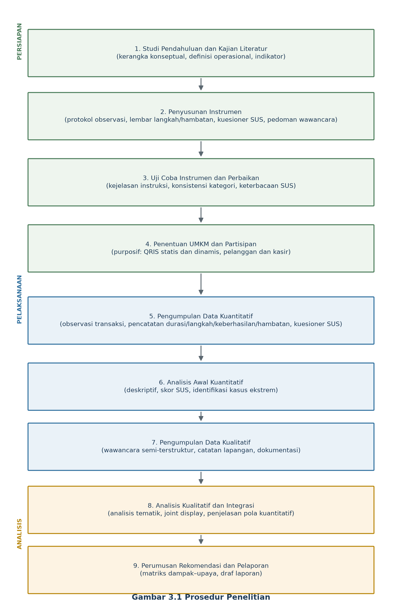
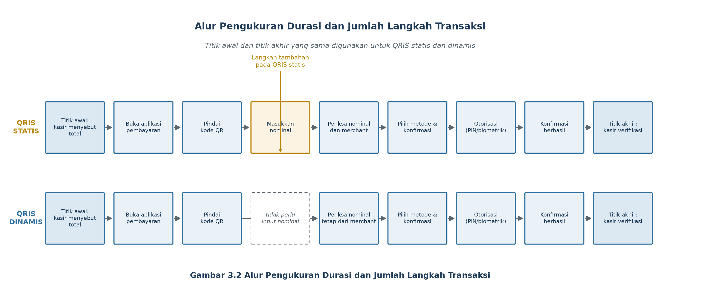

## **3.1 Pendekatan, Jenis, dan Prosedur Penelitian**

### **3.1.1 Pendekatan Penelitian**

Penelitian ini menggunakan pendekatan campuran (*mixed methods*) dengan desain *explanatory sequential*. Pendekatan kuantitatif digunakan untuk menjawab pertanyaan penelitian mengenai tingkat efisiensi pembayaran QRIS, tingkat usability berdasarkan skor *System Usability Scale* (SUS), serta perbedaan efisiensi antara QRIS statis dan QRIS dinamis. Pendekatan kualitatif digunakan untuk menjelaskan alasan di balik pola kuantitatif tersebut, terutama hambatan teknis dan non-teknis yang dialami pelanggan maupun kasir, serta persepsi pengguna terhadap kejelasan, kemudahan, dan kepercayaan dalam proses pembayaran. Integrasi kedua jenis data dilakukan pada tahap interpretasi melalui *joint display*, yaitu tabel yang mempertemukan temuan kuantitatif dengan penjelasan kualitatif untuk menghasilkan interpretasi dan rekomendasi yang utuh (Creswell & Plano Clark, 2018; Fetters et al., 2013).

Desain *explanatory sequential* dipilih karena data kuantitatif dikumpulkan dan dianalisis terlebih dahulu, kemudian data kualitatif dikumpulkan untuk menjelaskan hasil tersebut. Urutan ini sesuai dengan tujuan penelitian yang menempatkan pengukuran efisiensi dan usability sebagai fokus utama, sementara wawancara berfungsi memperdalam pemahaman terhadap pengalaman pengguna. Dengan demikian, penelitian ini tidak sekadar menggabungkan kuesioner dan wawancara, tetapi menetapkan secara eksplisit bagaimana kedua data saling melengkapi pada tahap analisis dan penarikan kesimpulan.

### **3.1.2 Jenis dan Desain Penelitian**

Berdasarkan tujuannya, penelitian ini merupakan penelitian evaluatif deskriptif dengan studi lapangan (*field study*). Penelitian evaluatif dipilih karena objek yang dikaji adalah proses pembayaran QRIS yang sudah berjalan di UMKM, bukan sistem baru yang dikembangkan oleh peneliti. Penelitian deskriptif digunakan untuk menggambarkan durasi transaksi, jumlah langkah, tingkat keberhasilan, hambatan, dan skor SUS secara sistematis. Studi lapangan dipilih agar pengukuran dilakukan pada konteks penggunaan nyata, yaitu di meja kasir atau area pembayaran UMKM, sehingga perilaku yang diamati mencerminkan kondisi aktual, bukan simulasi laboratorium.

Penelitian ini tidak dirancang sebagai eksperimen karena peneliti tidak memanipulasi jenis QRIS, nominal transaksi, atau perlakuan pengguna. Jenis QRIS yang digunakan merupakan kondisi yang telah ditentukan oleh masing-masing UMKM. Komponen perbandingan antara QRIS statis dan QRIS dinamis bersifat komparatif, bukan kausal, sehingga perbedaan yang ditemukan tidak dapat secara langsung diatribusikan hanya kepada jenis QRIS tanpa mempertimbangkan karakteristik UMKM, pengalaman kasir, dan kondisi teknis pada saat observasi. Keterbatasan ini dijelaskan pada bagian analisis dan pembahasan.

Usability testing dalam penelitian ini bersifat formatif, yaitu evaluasi yang bertujuan menemukan masalah dan merumuskan perbaikan, bukan evaluasi sumatif untuk memberi peringkat akhir suatu produk. Pengujian dilakukan berbasis tugas (*task-based testing*) pada transaksi nyata dengan campur tangan moderator yang dibatasi sekecil mungkin. Pendekatan ini sejalan dengan praktik usability testing yang menekankan pengamatan perilaku pengguna saat menyelesaikan tugas dalam konteks yang mendekati penggunaan sesungguhnya (Nielsen, 1994; Rubin & Chisnell, 2008; Tullis & Albert, 2013).

### **3.1.3 Prosedur Penelitian**

Prosedur penelitian disusun dalam sembilan tahap yang saling terkait. Tahap pertama adalah studi pendahuluan dan kajian literatur untuk memantapkan kerangka konseptual, definisi operasional, dan indikator pengukuran. Tahap kedua adalah penyusunan instrumen, yang meliputi protokol observasi transaksi, lembar pencatatan langkah dan hambatan, kuesioner SUS berbahasa Indonesia, pedoman wawancara semi-terstruktur, serta formulir persetujuan partisipan. Tahap ketiga adalah uji coba instrumen pada sejumlah kecil transaksi dan partisipan untuk memeriksa kejelasan instruksi, kelayakan waktu pengamatan, dan konsistensi kategori pengamatan. Tahap keempat adalah penentuan UMKM dan partisipan berdasarkan kriteria purposif yang telah ditetapkan.

Tahap kelima adalah pengumpulan data kuantitatif melalui observasi transaksi QRIS statis dan dinamis serta pemberian kuesioner SUS kepada pelanggan dan kasir setelah transaksi selesai. Tahap keenam adalah analisis awal data kuantitatif untuk memperoleh gambaran deskriptif dan mengidentifikasi kasus ekstrem atau pola yang memerlukan penjelasan. Tahap ketujuh adalah pengumpulan data kualitatif melalui wawancara semi-terstruktur dengan informan yang dipilih secara purposif, dengan fokus pada pengalaman, hambatan, dan saran perbaikan. Tahap kedelapan adalah analisis kualitatif dan integrasi temuan kuantitatif dan kualitatif. Tahap kesembilan adalah perumusan rekomendasi dan penyusunan laporan. Alur prosedur penelitian disajikan pada Gambar 3.1.

**Gambar 3.1 Prosedur Penelitian**

Rincian kegiatan dan luaran setiap tahap disajikan pada Tabel 3.1. Jadwal yang tercantum merupakan rencana relatif dan akan disesuaikan dengan izin lokasi, ketersediaan partisipan, serta kalender akademik. Tanggal pelaksanaan akhir ditandai sebagai informasi yang masih perlu dikonfirmasi.

**Tabel 3.1 Timeline Rencana Penelitian**

| Tahap | Kegiatan | Luaran | Perkiraan Waktu |
| :--- | :--- | :--- | :--- |
| 1 | Studi pendahuluan dan kajian literatur | Kerangka konseptual, definisi operasional, dan indikator | Minggu 1–2 |
| 2 | Penyusunan instrumen penelitian | Protokol observasi, kuesioner SUS, pedoman wawancara, formulir persetujuan | Minggu 2–3 |
| 3 | Uji coba instrumen dan perbaikan | Instrumen final dan catatan perbaikan | Minggu 3–4 |
| 4 | Penentuan UMKM dan partisipan | Daftar UMKM dan partisipan yang memenuhi kriteria | Minggu 4 |
| 5 | Pengumpulan data kuantitatif | Data durasi, langkah, keberhasilan, hambatan, dan skor SUS | Minggu 4–6 |
| 6 | Analisis awal data kuantitatif | Statistik deskriptif dan daftar kasus yang perlu dijelaskan | Minggu 6–7 |
| 7 | Pengumpulan data kualitatif | Transkrip wawancara dan catatan lapangan | Minggu 7–8 |
| 8 | Analisis kualitatif dan integrasi | Tema, *joint display*, dan interpretasi | Minggu 8–9 |
| 9 | Perumusan rekomendasi dan pelaporan | Rekomendasi dan draf laporan | Minggu 9–10 |

Sumber: Rencana penelitian (2026)

### **3.1.4 Prosedur Usability Testing dan Pengamatan Transaksi**

Usability testing dilaksanakan pada transaksi pembayaran yang benar-benar terjadi di UMKM. Partisipan tidak diminta melakukan transaksi fiktif dengan nominal yang direkayasa, tetapi menyelesaikan pembayaran atas pembelian yang memang dilakukan. Peneliti berperan sebagai pengamat pasif dan hanya memberikan bantuan apabila partisipan mengalami kebuntuan yang berpotensi mengganggu antrean atau merugikan pihak lain. Setiap bantuan yang diberikan dicatat sebagai bagian dari hambatan dan menyebabkan transaksi diklasifikasikan sebagai berhasil dengan bantuan, bukan berhasil mandiri.

Setiap sesi pengamatan menggunakan skenario tugas yang sama untuk kedua jenis QRIS, yaitu pelanggan menyelesaikan pembayaran melalui aplikasi pembayaran yang dipilih sendiri, kemudian kasir memverifikasi bahwa pembayaran telah diterima. Pada QRIS statis, pelanggan harus memasukkan nominal secara manual setelah memindai kode. Pada QRIS dinamis, nominal telah ditetapkan oleh merchant sehingga pelanggan hanya perlu memeriksa nominal, memilih metode pembayaran, dan mengotorisasi transaksi. Perbedaan langkah inilah yang menjadi dasar pengukuran jumlah langkah dan durasi transaksi.

Pengamatan dilakukan dengan dua pengamat pada sebagian sesi untuk memeriksa konsistensi pencatatan. Pengamat pertama mencatat waktu dan urutan langkah, sedangkan pengamat kedua mencatat kategori hambatan dan kejadian khusus. Perekaman layar atau video diarahkan pada area transaksi dan perangkat, bukan pada wajah atau identitas pelanggan. Apabila perekaman tidak memungkinkan karena kebijakan lokasi, pengukuran dilakukan dengan *stopwatch* dan lembar observasi tercetak.

### **3.1.5 Prosedur Perbandingan QRIS Statis dan QRIS Dinamis**

Perbandingan dilakukan dengan membandingkan transaksi yang menggunakan QRIS statis dan transaksi yang menggunakan QRIS dinamis pada UMKM yang memenuhi kriteria. Unit perbandingan adalah transaksi, bukan partisipan, karena pertanyaan penelitian ketiga berkaitan dengan efisiensi proses pembayaran. Setiap transaksi dicatat sebagai satu observasi dengan atribut jenis QRIS, durasi, jumlah langkah, status keberhasilan, dan kategori hambatan.

Apabila suatu UMKM menggunakan kedua jenis QRIS dan memungkinkan untuk dilakukan pencocokan transaksi berdasarkan karakteristik tertentu, analisis tambahan dengan pendekatan berpasangan (*paired*) dapat dilakukan. Sebaliknya, apabila transaksi statis dan dinamis berasal dari UMKM yang berbeda, analisis utama menggunakan pendekatan kelompok independen (*independent groups*). Keputusan mengenai pendekatan analisis ditetapkan setelah struktur data akhir diketahui dan dilaporkan secara transparan. Untuk mengurangi potensi faktor perancu, karakteristik UMKM seperti sektor usaha, perkiraan volume transaksi harian, dan pengalaman kasir dicatat sebagai variabel kontekstual, meskipun tidak diuji sebagai variabel bebas.

## **3.2 Lokasi Penelitian**

Penelitian dilaksanakan pada UMKM yang menerima pembayaran QRIS di **[TO BE CONFIRMED]**. Lokasi penelitian belum dapat ditetapkan secara definitif pada tahap proposal karena masih menunggu izin pemilik UMKM dan penyesuaian dengan jadwal operasional. Kriteria pemilihan lokasi adalah sebagai berikut.

1. UMKM telah menggunakan QRIS sebagai metode pembayaran selama minimal tiga bulan.
2. UMKM menggunakan QRIS *Merchant Presented Mode* (MPM), baik statis maupun dinamis.
3. UMKM memiliki transaksi QRIS yang cukup sering sehingga pengamatan dapat dilakukan dalam waktu yang wajar.
4. Pemilik UMKM memberikan izin tertulis atau lisan untuk pelaksanaan observasi, wawancara, dan dokumentasi.
5. Lokasi dapat dijangkau peneliti dan memungkinkan pengamatan tanpa mengganggu proses pelayanan.

Alasan pemilihan UMKM sebagai lokasi penelitian adalah karena UMKM merupakan kelompok pengguna QRIS yang paling dekat dengan transaksi sehari-hari dan paling merasakan dampak efisiensi pembayaran terhadap antrean, kecepatan layanan, dan pengalaman pelanggan. Sejumlah studi menunjukkan bahwa adopsi QRIS pada UMKM dipengaruhi oleh persepsi kemudahan, manfaat, serta hambatan teknis dan non-teknis (Setiawan & Mahyuni, 2020; Yuliati & Handayani, 2021). Selain itu, UMKM memiliki variasi jenis QRIS yang memungkinkan perbandingan statis dan dinamis dilakukan dalam konteks yang relatif serupa.

Ruang lingkup lokasi dibatasi pada area pembayaran di dalam atau di sekitar tempat usaha, termasuk meja kasir, area swalayan, dan area pengambilan pesanan. Penelitian tidak mencakup transaksi daring yang tidak melibatkan interaksi tatap muka antara pelanggan dan kasir. Periode penelitian direncanakan pada **[TO BE CONFIRMED]** dan akan disesuaikan dengan jam operasional UMKM, misalnya pada jam sibuk dan jam sepi untuk memperoleh variasi kondisi transaksi.

## **3.3 Populasi dan Sampel**

### **3.3.1 Populasi**

Populasi penelitian ini terdiri atas dua tingkat. Pertama, populasi transaksi, yaitu seluruh transaksi pembayaran QRIS yang terjadi pada UMKM yang memenuhi kriteria lokasi penelitian selama periode pengamatan. Kedua, populasi pengguna, yaitu seluruh pelanggan yang melakukan pembayaran QRIS dan seluruh kasir atau pemilik UMKM yang mengoperasikan QRIS di lokasi tersebut. Populasi transaksi digunakan untuk menjawab pertanyaan penelitian tentang efisiensi, sedangkan populasi pengguna digunakan untuk menjawab pertanyaan penelitian tentang usability melalui SUS dan wawancara.

Karena tidak tersedia kerangka sampel (*sampling frame*) yang lengkap dan mutakhir, penelitian ini tidak menggunakan sampel acak probabilistik. Populasi penelitian bersifat terbatas pada UMKM yang bersedia dan memenuhi kriteria, sehingga hasil penelitian tidak dapat digeneralisasikan kepada seluruh UMKM di Indonesia. Generalisasi yang dimungkinkan adalah generalisasi analitis terhadap konsep efisiensi dan usability pembayaran QRIS, bukan generalisasi statistik terhadap populasi nasional.

### **3.3.2 Unit Analisis dan Unit Observasi**

Unit analisis penelitian ini berbeda sesuai pertanyaan penelitian. Untuk pertanyaan penelitian tentang efisiensi dan perbandingan QRIS statis–dinamis, unit analisis adalah satu peristiwa transaksi pembayaran. Untuk pertanyaan penelitian tentang usability, unit analisis adalah individu, yaitu pelanggan atau kasir yang mengisi kuesioner SUS. Untuk pertanyaan penelitian tentang rekomendasi, unit analisis adalah tema atau kategori hambatan yang diidentifikasi dari observasi dan wawancara.

Unit observasi adalah objek yang diamati secara langsung, yaitu proses transaksi di area pembayaran, perilaku pelanggan dan kasir selama transaksi, serta kondisi perangkat dan jaringan yang digunakan. Pemisahan antara unit analisis dan unit observasi penting agar jumlah transaksi tidak disamakan dengan jumlah partisipan. Satu partisipan dapat terlibat dalam beberapa transaksi, dan satu transaksi dapat melibatkan dua partisipan, yaitu pelanggan dan kasir.

### **3.3.3 Teknik Sampling**

Pemilihan UMKM dilakukan secara purposif (*purposive sampling*) berdasarkan kriteria lokasi yang telah ditetapkan. Teknik ini dipilih karena penelitian membutuhkan UMKM yang benar-benar menggunakan QRIS dan dapat diakses selama periode penelitian, bukan sampel acak yang mungkin tidak memenuhi kebutuhan observasi. Untuk memperoleh variasi, UMKM dipilih dengan mempertimbangkan sektor usaha, perkiraan volume transaksi, dan jenis QRIS yang digunakan.

Pengambilan data transaksi dilakukan secara konsekutif (*consecutive sampling*) dalam jendela observasi yang telah ditentukan. Setiap transaksi yang memenuhi kriteria inklusi dicatat sampai jumlah target terpenuhi atau periode observasi berakhir. Teknik ini dipilih karena peneliti tidak dapat mengendalikan siapa yang datang dan bertransaksi pada saat observasi. Untuk mengurangi bias waktu, observasi dilakukan pada beberapa hari dan beberapa jam operasional yang berbeda.

Partisipan SUS dipilih secara purposif-konveniens, yaitu pelanggan dan kasir yang baru saja menyelesaikan transaksi QRIS dan bersedia mengisi kuesioner. Partisipan wawancara dipilih secara purposif dengan variasi maksimum (*maximum variation sampling*) untuk mencakup pelanggan dan kasir, pengguna QRIS statis dan dinamis, serta pengguna dengan pengalaman yang berbeda. Teknik ini bertujuan memperoleh perspektif yang beragam, bukan representasi statistik.

### **3.3.4 Kriteria Inklusi dan Eksklusi**

Kriteria inklusi untuk UMKM adalah: (a) menggunakan QRIS MPM, (b) memiliki transaksi QRIS selama periode observasi, (c) pemilik atau pengelola memberikan izin, dan (d) lokasi dapat diakses tanpa mengganggu operasional. Kriteria eksklusi untuk UMKM adalah: (a) hanya menerima pembayaran tunai atau transfer non-QRIS, (b) sedang mengalami gangguan sistem yang permanen sehingga transaksi tidak dapat berjalan, dan (c) tidak bersedia diobservasi.

Kriteria inklusi untuk transaksi adalah: (a) transaksi dilakukan melalui QRIS statis atau dinamis, (b) pelanggan dan kasir terlibat secara langsung, (c) transaksi memiliki titik awal dan titik akhir yang dapat diamati, dan (d) data durasi serta langkah dapat dicatat secara lengkap. Kriteria eksklusi untuk transaksi adalah: (a) transaksi dibatalkan sebelum upaya pembayaran dimulai, (b) transaksi merupakan uji coba perangkat atau transaksi internal yang tidak melibatkan pelanggan, dan (c) data tidak lengkap karena perangkat mati atau pengamat kehilangan pandangan.

Kriteria inklusi untuk partisipan SUS dan wawancara adalah: (a) berusia minimal 17 tahun, (b) pernah menyelesaikan pembayaran QRIS di UMKM yang diteliti, (c) bersedia memberikan persetujuan, dan (d) dapat berkomunikasi dalam Bahasa Indonesia. Kriteria eksklusi adalah partisipan yang tidak menyelesaikan kuesioner, memberikan jawaban tidak lengkap, atau menarik diri di tengah proses.

### **3.3.5 Ukuran Sampel dan Justifikasi**

Jumlah sampel dalam penelitian ini dibedakan menjadi jumlah UMKM, jumlah transaksi, jumlah responden SUS, dan jumlah informan wawancara. Pembedaan ini penting karena masing-masing memiliki dasar pertimbangan metodologis yang berbeda.

Jumlah UMKM ditetapkan secara purposif dengan minimal dua UMKM untuk setiap jenis QRIS, sehingga perbandingan awal antara QRIS statis dan dinamis dapat dilakukan. Jumlah final UMKM adalah **[TO BE CONFIRMED]** dan akan disesuaikan dengan izin serta ketersediaan lokasi. Untuk mengurangi confounding, UMKM diupayakan memiliki karakteristik yang relatif sebanding dalam hal sektor usaha dan kompleksitas layanan.

Jumlah transaksi ditargetkan minimal 30 transaksi per jenis QRIS, sehingga total minimal 60 transaksi. Angka ini digunakan sebagai target operasional agar distribusi rata-rata durasi mendekati normal berdasarkan teorema limit pusat dan agar uji non-parametrik memiliki daya yang memadai untuk mendeteksi perbedaan yang cukup besar (Field, 2018). Perhitungan daya uji *a priori* untuk uji-t independen dua sisi dengan taraf signifikansi 0,05, daya 0,80, dan *effect size* sedang (*d* = 0,50) menghasilkan kebutuhan sekitar 64 transaksi per kelompok (Cohen, 1988). Karena penelitian ini merupakan studi lapangan dengan keterbatasan akses, target 30 transaksi per jenis ditetapkan sebagai batas minimal, sedangkan penambahan hingga 64 transaksi per jenis dilakukan apabila kondisi lapangan memungkinkan. Daya uji dan *effect size* akan dilaporkan secara transparan apabila jumlah transaksi yang diperoleh berada di bawah perhitungan ideal.

Jumlah responden SUS ditargetkan minimal 20 pelanggan dan 20 kasir atau pengelola UMKM. Dengan asumsi simpangan baku skor SUS sekitar 17 poin, jumlah tersebut memberikan galat baku sekitar 3,8 poin dan interval kepercayaan 95% sekitar ±7,5 poin, sehingga cukup untuk memberikan gambaran rata-rata usability pada tingkat kelompok. Angka ini bukan angka mutlak, tetapi target operasional yang dapat dipertanggungjawabkan untuk penelitian evaluatif berskala kecil. Untuk keperluan evaluasi usability formatif, Hwang dan Salvendy (2010) mengusulkan aturan 10±2, yaitu sekitar 10 hingga 12 partisipan per evaluasi, dengan jumlah yang dapat bervariasi menurut kompleksitas sistem. Oleh karena itu, target 20 responden per kelompok dalam penelitian ini bersifat konservatif dan disesuaikan dengan kebutuhan analisis SUS, bukan semata-mata mengikuti angka 5 pengguna yang sering dikutip. Apabila memungkinkan, jumlah responden ditambah untuk memperkecil interval kepercayaan.

Jumlah informan wawancara ditargetkan minimal enam orang per kelompok, yaitu pelanggan dan kasir/pengelola, dan dilanjutkan hingga tidak ditemukan tema baru (*data saturation*). Guest et al. (2006) menunjukkan bahwa untuk kelompok yang relatif homogen, sejumlah kecil wawancara dapat mengidentifikasi tema-tema utama, sedangkan tema yang lebih rinci memerlukan jumlah yang lebih besar. Oleh karena itu, jumlah informan tidak ditetapkan secara kaku, tetapi dihentikan berdasarkan kriteria kejenuhan data yang didokumentasikan dalam catatan penelitian.

## **3.4 Variabel Penelitian dan Definisi Operasional**

### **3.4.1 Jenis Variabel**

Variabel dalam penelitian ini dikelompokkan menjadi variabel kelompok, variabel terikat, dan variabel kontekstual. Variabel kelompok utama adalah jenis QRIS, yaitu QRIS statis dan QRIS dinamis, yang berskala nominal. Variabel terikat pertama adalah efisiensi pembayaran QRIS, yang diukur melalui empat indikator, yaitu durasi transaksi, jumlah langkah, tingkat keberhasilan, dan hambatan. Variabel terikat kedua adalah usability pembayaran QRIS, yang diukur melalui skor SUS. Variabel kontekstual meliputi peran pengguna (pelanggan atau kasir), pengalaman menggunakan QRIS, jenis perangkat, dan karakteristik UMKM. Variabel kontekstual tidak diuji sebagai variabel bebas, tetapi digunakan untuk mendeskripsikan kondisi penelitian dan membantu interpretasi.

Perlu ditegaskan bahwa sepuluh item SUS bukan merupakan sepuluh variabel penelitian yang berdiri sendiri. Item-item tersebut merupakan indikator reflektif dari satu konstruk usability, sehingga analisis utama dilakukan pada skor komposit SUS dalam rentang 0–100. Pemilahan per item hanya digunakan untuk keperluan diagnostik, misalnya mengidentifikasi item yang paling rendah, dan tidak digunakan untuk menguji hipotesis antarvariabel.

### **3.4.2 Definisi Operasional Variabel**

Definisi operasional disusun agar setiap konstruk dapat diamati dan diukur secara konsisten. Tabel 3.2 menyajikan definisi operasional, indikator, cara pengukuran, skala, dan sumber data untuk setiap variabel.

**Tabel 3.2 Definisi Operasional Variabel**

| Variabel/Konstruk | Definisi Operasional | Indikator | Cara Pengukuran | Skala | Sumber Data |
| :--- | :--- | :--- | :--- | :--- | :--- |
| Jenis QRIS (X) | Jenis kode QR yang digunakan pada transaksi, yaitu QRIS statis yang nominalnya dimasukkan pelanggan atau QRIS dinamis yang nominalnya ditetapkan merchant. | Kategori QRIS statis dan QRIS dinamis. | Klasifikasi berdasarkan tampilan kode QR dan alur transaksi; dicatat pada lembar observasi. | Nominal | Observasi dan dokumentasi |
| Durasi transaksi (Y1a) | Waktu yang dibutuhkan sejak titik awal pembayaran sampai pembayaran dikonfirmasi berhasil. | Lama transaksi dalam detik. | *Stopwatch* atau *timestamp* video; dihitung selisih waktu akhir dan awal. | Rasio (detik) | Observasi |
| Jumlah langkah (Y1b) | Banyaknya tindakan diskret yang dilakukan pelanggan dan kasir dari titik awal sampai pembayaran dikonfirmasi. | Jumlah langkah teramati. | Penghitungan berdasarkan taksonomi langkah pada bagian 3.7.1. | Rasio (cacah) | Observasi |
| Tingkat keberhasilan (Y1c) | Proporsi transaksi yang berhasil diselesaikan dan dikonfirmasi terhadap seluruh transaksi yang diamati. | Persentase transaksi berhasil. | Jumlah transaksi berhasil dibagi jumlah transaksi yang diamati, dikali 100%. | Rasio (persen) | Observasi |
| Hambatan (Y1d) | Kejadian teknis atau non-teknis yang memperlambat, menghentikan, atau menyulitkan proses pembayaran. | Jenis, frekuensi, dan durasi hambatan. | Klasifikasi berdasarkan tabel kategori hambatan; dicatat dalam catatan lapangan. | Nominal dan rasio | Observasi dan wawancara |
| Skor SUS (Y2) | Skor komposit 0–100 yang menggambarkan persepsi usability pengguna terhadap pembayaran QRIS. | Skor total SUS. | Kuesioner 10 item skala Likert 1–5; dihitung dengan rumus SUS. | Interval (0–100) | Kuesioner |

Sumber: Diolah peneliti berdasarkan ISO (2018), Brooke (1996), dan Sauro & Lewis (2016)

### **3.4.3 Indikator, Instrumen, dan Sumber Data**

Tabel 3.3 merinci indikator, instrumen, skala, dan sumber data untuk setiap variabel. Tabel ini berfungsi sebagai penghubung antara definisi operasional dan teknik pengumpulan data pada bagian 3.7.

**Tabel 3.3 Indikator, Instrumen, Skala, dan Sumber Data**

| Variabel | Indikator | Instrumen | Skala | Sumber Data |
| :--- | :--- | :--- | :--- | :--- |
| Efisiensi: durasi | Detik dari awal sampai konfirmasi | Lembar observasi dan *stopwatch*/video | Rasio | Transaksi |
| Efisiensi: langkah | Jumlah tindakan diskret | Lembar taksonomi langkah | Rasio | Transaksi |
| Efisiensi: keberhasilan | Persentase transaksi berhasil | Lembar observasi | Rasio | Transaksi |
| Efisiensi: hambatan | Jenis dan frekuensi hambatan | Lembar kategori hambatan dan catatan lapangan | Nominal | Transaksi dan wawancara |
| Usability | Skor SUS 0–100 | Kuesioner SUS 10 item | Interval | Pelanggan dan kasir |
| Konteks | Peran, pengalaman, jenis perangkat, karakteristik UMKM | Lembar profil responden dan catatan lapangan | Nominal/ordinal | Responden dan observasi |

Sumber: Diolah peneliti (2026)

## **3.5 Hipotesis Statistik**

Hipotesis statistik dirumuskan hanya untuk pertanyaan penelitian ketiga, yaitu perbandingan efisiensi antara QRIS statis dan QRIS dinamis. Pertanyaan penelitian pertama dan kedua bersifat deskriptif, sedangkan pertanyaan penelitian keempat bersifat eksploratif dan menghasilkan rekomendasi, sehingga tidak memerlukan hipotesis statistik. Perumusan hipotesis pada bagian ini tidak dimaksudkan untuk memaksakan pengujian inferensial pada data yang bersifat deskriptif, tetapi untuk menyediakan kerangka pengujian yang eksplisit apabila data memenuhi syarat.

Hipotesis statistik untuk durasi transaksi dirumuskan sebagai berikut.

H₀₁: Tidak terdapat perbedaan rata-rata durasi transaksi antara QRIS statis dan QRIS dinamis.

H₁₁: Terdapat perbedaan rata-rata durasi transaksi antara QRIS statis dan QRIS dinamis.

Hipotesis statistik untuk jumlah langkah dirumuskan sebagai berikut.

H₀₂: Tidak terdapat perbedaan rata-rata jumlah langkah transaksi antara QRIS statis dan QRIS dinamis.

H₁₂: Terdapat perbedaan rata-rata jumlah langkah transaksi antara QRIS statis dan QRIS dinamis.

Hipotesis statistik untuk tingkat keberhasilan dirumuskan sebagai berikut.

H₀₃: Tidak terdapat perbedaan proporsi keberhasilan transaksi antara QRIS statis dan QRIS dinamis.

H₁₃: Terdapat perbedaan proporsi keberhasilan transaksi antara QRIS statis dan QRIS dinamis.

Seluruh pengujian menggunakan uji dua sisi dengan taraf signifikansi α = 0,05. Pemilihan uji statistik tidak ditetapkan sebelum data diperiksa. Apabila data berdistribusi normal dan varians antar kelompok homogen, uji-t independen digunakan untuk durasi dan jumlah langkah. Apabila asumsi tersebut tidak terpenuhi, uji Mann-Whitney U digunakan sebagai alternatif non-parametrik. Apabila transaksi dapat dipasangkan berdasarkan UMKM atau karakteristik tertentu, uji-t berpasangan atau uji Wilcoxon digunakan sebagai analisis tambahan. Untuk tingkat keberhasilan, uji chi-square digunakan apabila seluruh sel memenuhi syarat frekuensi harapan, sedangkan uji Fisher exact digunakan apabila syarat tersebut tidak terpenuhi. Keputusan penggunaan uji dan hasil pemeriksaan asumsi dilaporkan secara transparan.

## **3.6 Data dan Sumber Data**

Data yang digunakan dalam penelitian ini terdiri atas data primer dan data sekunder, serta data kuantitatif dan data kualitatif. Data primer merupakan data yang dikumpulkan langsung oleh peneliti melalui observasi transaksi, kuesioner SUS, wawancara, dan dokumentasi lapangan. Data sekunder merupakan data pendukung yang diperoleh dari dokumen UMKM, standar QRIS, literatur ilmiah, dan sumber resmi lainnya. Data sekunder tidak digunakan untuk menggantikan data primer, tetapi untuk memahami konteks, memverifikasi prosedur, dan membantu interpretasi.

Data kuantitatif meliputi durasi transaksi, jumlah langkah, status keberhasilan, frekuensi hambatan, dan skor SUS. Data kualitatif meliputi catatan lapangan, transkrip wawancara, deskripsi hambatan, dan dokumentasi visual yang tidak memuat identitas. Tabel 3.4 merangkum jenis, sumber, dan kegunaan data.

**Tabel 3.4 Jenis dan Sumber Data**

| Jenis Data | Bentuk Data | Sumber | Kegunaan |
| :--- | :--- | :--- | :--- |
| Kuantitatif primer | Durasi, jumlah langkah, status keberhasilan, frekuensi hambatan | Observasi transaksi | Menjawab pertanyaan efisiensi dan perbandingan QRIS |
| Kuantitatif primer | Skor SUS | Kuesioner pelanggan dan kasir | Menjawab pertanyaan usability |
| Kualitatif primer | Transkrip wawancara | Wawancara semi-terstruktur | Menjelaskan hambatan, persepsi, dan saran perbaikan |
| Kualitatif primer | Catatan lapangan dan dokumentasi | Observasi dan dokumentasi | Triangulasi dan konteks |
| Sekunder | Dokumen prosedur, standar QRIS, literatur | UMKM, ASPI/BI, jurnal | Verifikasi prosedur dan interpretasi |

Sumber: Diolah peneliti (2026)

Data yang dikumpulkan dibatasi pada data yang benar-benar diperlukan untuk menjawab pertanyaan penelitian. Peneliti tidak mengumpulkan nominal transaksi per pelanggan, identitas pelanggan, nomor referensi transaksi, nomor rekening UMKM, atau data sensitif lainnya. Apabila dokumentasi visual diperlukan, gambar diarahkan pada kode QR, perangkat, atau tata letak area pembayaran, bukan pada wajah, layar ponsel, atau struk pelanggan.

Matriks keselarasan antara rumusan masalah, data, instrumen, dan teknik analisis disajikan pada Tabel 3.5. Matriks ini digunakan sebagai kendali agar setiap pertanyaan penelitian memiliki data dan analisis yang sesuai.

**Tabel 3.5 Matriks Keselarasan Rumusan Masalah, Data, dan Analisis**

| Rumusan Masalah | Data yang Dibutuhkan | Instrumen | Teknik Analisis | Luaran |
| :--- | :--- | :--- | :--- | :--- |
| 1. Bagaimana tingkat efisiensi pembayaran QRIS? | Durasi, langkah, keberhasilan, hambatan | Protokol observasi | Statistik deskriptif, proporsi, kategori hambatan | Profil efisiensi |
| 2. Bagaimana tingkat usability pembayaran QRIS? | Skor SUS pelanggan dan kasir | Kuesioner SUS | Skor komposit, deskriptif, interval kepercayaan | Profil usability |
| 3. Apakah terdapat perbedaan efisiensi QRIS statis dan dinamis? | Durasi, langkah, keberhasilan per jenis QRIS | Protokol observasi | Uji normalitas, uji-t/Mann-Whitney, chi-square/Fisher, *effect size* | Hasil perbandingan |
| 4. Rekomendasi perbaikan apa yang dapat diberikan? | Temuan kuantitatif dan kualitatif | Wawancara, catatan lapangan | Analisis tematik, *joint display*, matriks dampak–upaya | Rekomendasi |

Sumber: Diolah peneliti (2026)

## **3.7 Teknik Pengumpulan Data**

### **3.7.1 Observasi Transaksi**

Observasi transaksi merupakan teknik utama untuk mengukur efisiensi. Observasi dilakukan secara terstruktur dengan menggunakan lembar observasi yang telah diuji coba. Sebelum observasi dimulai, peneliti mencatat identitas kode UMKM (bukan nama sebenarnya), jenis QRIS, tanggal, jam, peran pengguna, jenis perangkat, dan perkiraan kondisi jaringan. Data identitas UMKM diberi kode untuk menjaga kerahasiaan.

Titik awal transaksi ditetapkan pada saat kasir menyatakan total pembayaran atau pada saat pelanggan mulai membuka aplikasi pembayaran, mana yang lebih dahulu terjadi. Titik akhir ditetapkan pada saat aplikasi pembayaran menampilkan konfirmasi berhasil dan kasir menyatakan pembayaran diterima. Apabila kasir memerlukan pemeriksaan tambahan, waktu pemeriksaan tetap dihitung sampai kasir menyatakan transaksi selesai. Definisi ini digunakan secara konsisten untuk kedua jenis QRIS agar perbandingan durasi valid.

Jumlah langkah dihitung berdasarkan taksonomi berikut: (1) membuka aplikasi pembayaran, (2) memilih menu pemindaian atau pembayaran QR, (3) mengarahkan kamera ke kode QR, (4) menunggu kode terbaca, (5) memasukkan nominal (khusus QRIS statis), (6) memeriksa nominal dan nama merchant, (7) memilih metode pembayaran, (8) mengonfirmasi pembayaran, (9) melakukan otorisasi (PIN, biometrik, atau kata sandi), (10) menunggu proses, (11) menerima bukti pembayaran, dan (12) menunjukkan bukti kepada kasir. Langkah yang tidak muncul tidak dihitung. Apabila terjadi pengulangan langkah karena kesalahan, pengulangan tetap dihitung sebagai langkah tambahan dan dicatat sebagai hambatan. Perbedaan alur antara QRIS statis dan QRIS dinamis, khususnya keberadaan langkah memasukkan nominal, diilustrasikan pada Gambar 3.2.

**Gambar 3.2 Alur Pengukuran Durasi dan Jumlah Langkah Transaksi**

Status keberhasilan diklasifikasikan menjadi tiga kategori, yaitu berhasil mandiri, berhasil dengan bantuan, dan gagal. Berhasil mandiri berarti transaksi selesai tanpa bantuan peneliti. Berhasil dengan bantuan berarti transaksi selesai setelah peneliti atau kasir memberikan petunjuk. Gagal berarti transaksi tidak selesai sampai batas waktu yang ditetapkan atau dibatalkan. Batas waktu maksimal untuk menyelesaikan satu transaksi ditetapkan 120 detik; apabila melewati batas tersebut, transaksi dicatat sebagai gagal dan pengamatan dihentikan untuk menghindari gangguan layanan.

Hambatan dicatat berdasarkan kategori teknis dan non-teknis. Hambatan teknis meliputi jaringan internet tidak stabil, kode QR tidak terbaca, aplikasi pembayaran mengalami galat, server lambat, perangkat mati, dan notifikasi pembayaran tidak muncul. Hambatan non-teknis meliputi kebingungan memasukkan nominal, salah memahami instruksi, ragu memilih metode pembayaran, antrean panjang, pencahayaan kurang, kode QR sulit dijangkau, dan komunikasi kasir–pelanggan yang tidak jelas. Setiap hambatan dicatat jenis, waktu kejadian, durasi, dan dampaknya terhadap transaksi. Klasifikasi hambatan yang digunakan dalam penelitian ini disajikan pada Tabel 3.6.

**Tabel 3.6 Klasifikasi Hambatan Pembayaran QRIS**

| Kategori | Subkategori | Contoh Kejadian |
| :--- | :--- | :--- |
| Teknis | Jaringan dan konektivitas | Internet lambat, koneksi terputus, sinyal lemah |
| Teknis | Perangkat dan antarmuka | Kamera gagal fokus, aplikasi *freeze*, perangkat mati |
| Teknis | Sistem pembayaran | Kode QR tidak terbaca, server lambat, notifikasi tidak muncul |
| Non-teknis | Kesalahan pengguna | Salah memasukkan nominal, salah memilih metode pembayaran |
| Non-teknis | Kebingungan dan pemahaman | Tidak memahami instruksi, ragu mengonfirmasi, tidak menemukan tombol |
| Non-teknis | Lingkungan dan layanan | Antrean panjang, pencahayaan kurang, kode QR sulit dijangkau |
| Non-teknis | Komunikasi | Instruksi kasir tidak jelas, pelanggan dan kasir saling menunggu |

Sumber: Diolah peneliti (2026)

Kategori pada Tabel 3.6 tidak bersifat saling eksklusif secara mutlak karena satu kejadian dapat melibatkan lebih dari satu faktor. Apabila hal tersebut terjadi, pengamat mencatat kategori yang paling dominan menyebabkan perlambatan atau kegagalan, kemudian menambahkan catatan naratif mengenai faktor lain yang terlibat.

### **3.7.2 Usability Testing**

Usability testing dilaksanakan bersamaan dengan observasi transaksi agar pengukuran perilaku dan persepsi berada dalam konteks yang sama. Partisipan diberikan penjelasan singkat mengenai tujuan penelitian dan diminta menyelesaikan pembayaran seperti biasa. Peneliti tidak mengarahkan pilihan aplikasi pembayaran, metode otorisasi, atau cara memindai kode. Apabila partisipan bertanya, peneliti memberikan jawaban netral dan mencatat pertanyaan tersebut sebagai indikasi kebingungan.

Setelah transaksi selesai, peneliti melakukan *retrospective probing* singkat untuk menggali alasan di balik tindakan partisipan, misalnya alasan memilih metode pembayaran tertentu atau kesulitan yang dialami. *Concurrent think-aloud* tidak digunakan sebagai prosedur utama karena dapat mengganggu transaksi nyata dan mengubah perilaku partisipan. *Think-aloud* hanya digunakan secara terbatas apabila partisipan bersedia dan kondisi memungkinkan.

Keberhasilan tugas diukur dengan kriteria yang sama seperti observasi transaksi, yaitu berhasil mandiri, berhasil dengan bantuan, atau gagal. Waktu penyelesaian tugas dicatat sebagai bagian dari durasi transaksi. Setelah tugas selesai, partisipan diminta mengisi kuesioner SUS dan, apabila bersedia, mengikuti wawancara singkat.

### **3.7.3 Kuesioner System Usability Scale**

Kuesioner SUS terdiri atas sepuluh pernyataan dengan skala Likert 1–5, dari “sangat tidak setuju” sampai “sangat setuju”. SUS telah digunakan secara luas dalam evaluasi usability dan memiliki bukti validitas serta konsistensi internal yang memadai (Bangor et al., 2008; Lewis & Sauro, 2009). Kuesioner diberikan setelah partisipan menyelesaikan transaksi, bukan sebelum atau selama transaksi, agar penilaian didasarkan pada pengalaman yang baru saja dialami. Kuesioner disajikan dalam Bahasa Indonesia dan dilengkapi dengan versi asli Bahasa Inggris pada lampiran untuk menjaga ketertelusuran.

Tabel 3.7 menyajikan kisi-kisi kuesioner SUS beserta arah penskorannya. Item ganjil bersifat positif, sedangkan item genap bersifat negatif. Arah penskoran ini harus dipahami sebelum penghitungan skor dilakukan.

**Tabel 3.7 Kisi-kisi Instrumen System Usability Scale**

| No. | Pernyataan (Bahasa Indonesia) | Arah | Penskoran |
| :--- | :--- | :--- | :--- |
| 1 | Saya ingin sering menggunakan sistem pembayaran QRIS ini. | Positif | Skor = respons − 1 |
| 2 | Saya merasa sistem pembayaran QRIS ini terlalu rumit. | Negatif | Skor = 5 − respons |
| 3 | Saya merasa sistem pembayaran QRIS ini mudah digunakan. | Positif | Skor = respons − 1 |
| 4 | Saya membutuhkan bantuan teknis untuk dapat menggunakan sistem pembayaran QRIS ini. | Negatif | Skor = 5 − respons |
| 5 | Saya merasa berbagai fungsi dalam sistem pembayaran QRIS ini berjalan dengan baik. | Positif | Skor = respons − 1 |
| 6 | Saya merasa terlalu banyak ketidakkonsistenan dalam sistem pembayaran QRIS ini. | Negatif | Skor = 5 − respons |
| 7 | Saya membayangkan sebagian besar orang akan cepat belajar menggunakan sistem pembayaran QRIS ini. | Positif | Skor = respons − 1 |
| 8 | Saya merasa sistem pembayaran QRIS ini sangat canggung untuk digunakan. | Negatif | Skor = 5 − respons |
| 9 | Saya merasa percaya diri ketika menggunakan sistem pembayaran QRIS ini. | Positif | Skor = respons − 1 |
| 10 | Saya perlu belajar banyak hal sebelum dapat menggunakan sistem pembayaran QRIS ini. | Negatif | Skor = 5 − respons |

Sumber: Diadaptasi dari Brooke (1996) dan Lewis (2018)

### **3.7.4 Wawancara Semi-terstruktur**

Wawancara dilakukan dengan pelanggan dan kasir/pengelola UMKM yang dipilih secara purposif. Wawancara bertujuan menggali pengalaman penggunaan QRIS, persepsi kemudahan dan kejelasan, kepercayaan terhadap transaksi, hambatan yang pernah dialami, serta saran perbaikan. Wawancara berlangsung sekitar 20–30 menit dan dilakukan di tempat yang tenang, tanpa mengganggu operasional UMKM.

Pedoman wawancara bersifat semi-terstruktur, artinya peneliti menggunakan daftar topik utama, tetapi tetap memberi ruang untuk pertanyaan lanjutan sesuai jawaban informan. Topik wawancara mencakup: (a) pengalaman menggunakan QRIS statis dan dinamis, (b) langkah yang dirasa paling mudah dan paling sulit, (c) kejelasan informasi nominal dan nama merchant, (d) kepercayaan terhadap bukti pembayaran, (e) hambatan teknis dan non-teknis, (f) strategi yang digunakan ketika menghadapi hambatan, dan (g) saran perbaikan untuk UMKM dan penyedia aplikasi.

Wawancara direkam dengan izin informan. Apabila informan tidak bersedia direkam, peneliti membuat catatan tertulis dan merangkum jawaban pada akhir sesi. Transkrip dibuat secara *verbatim* dan dianonimkan dengan mengganti nama informan menggunakan kode, misalnya P-01 untuk pelanggan dan K-01 untuk kasir. Rekaman asli disimpan terpisah dari transkrip dan dihapus setelah analisis selesai.

### **3.7.5 Dokumentasi**

Dokumentasi digunakan untuk melengkapi data observasi dan wawancara. Dokumentasi meliputi catatan lapangan, foto tata letak area pembayaran, foto tampilan kode QR tanpa identitas, tangkapan layar antarmuka aplikasi pembayaran (tanpa data pribadi), dan dokumen prosedur pembayaran yang dimiliki UMKM. Dokumentasi tidak digunakan untuk mengumpulkan data pribadi atau data transaksi yang sensitif.

Catatan lapangan dibuat segera setelah observasi untuk merekam konteks yang tidak tertangkap oleh lembar observasi, misalnya kondisi antrean, pencahayaan, gangguan dari pihak lain, dan perilaku kasir. Catatan lapangan diberi tanggal, kode UMKM, dan kode pengamat untuk menjaga ketertelusuran.

### **3.7.6 Uji Coba Instrumen**

Uji coba instrumen dilakukan sebelum pengumpulan data utama pada satu UMKM dan sejumlah kecil partisipan yang tidak termasuk dalam sampel utama. Uji coba bertujuan memeriksa kejelasan instruksi, kelayakan waktu pengamatan, konsistensi kategori langkah dan hambatan, serta keterbacaan kuesioner SUS versi Bahasa Indonesia. Hasil uji coba digunakan untuk memperbaiki formulir, menyesuaikan urutan pertanyaan, dan melatih pengamat.

Uji coba tidak dimaksudkan untuk menghasilkan data penelitian, tetapi untuk memastikan instrumen dapat digunakan secara konsisten di lapangan. Perbaikan instrumen didokumentasikan dalam catatan revisi instrumen. Apabila terjadi perubahan besar, uji coba diulang pada sejumlah kecil transaksi.

## **3.8 Teknik Keabsahan Data**

### **3.8.1 Validitas dan Reliabilitas Data Kuantitatif**

Untuk instrumen SUS, validitas isi diperiksa melalui telaah instrumen oleh pembimbing atau ahli usability, terutama untuk memastikan bahwa terjemahan Bahasa Indonesia mempertahankan makna item asli. Proses penerjemahan dilakukan secara hati-hati, termasuk penerjemahan balik (*back translation*) apabila memungkinkan, untuk mengurangi pergeseran makna. Uji coba instrumen digunakan untuk memeriksa keterbacaan dan konsistensi jawaban.

Reliabilitas internal SUS akan diperiksa menggunakan koefisien Cronbach’s alpha apabila jumlah responden mencukupi. Nilai alpha yang tinggi menunjukkan konsistensi internal antaritem, tetapi tidak secara otomatis membuktikan validitas konstruk. Oleh karena itu, hasil alpha dilaporkan bersama statistik deskriptif item dan korelasi item–total. Peneliti tidak mengklaim bahwa uji validitas dan reliabilitas telah dilakukan sebelum data dikumpulkan; seluruh klaim akan didasarkan pada hasil uji yang sebenarnya.

Untuk data observasi, keabsahan diupayakan melalui protokol pengamatan yang terstandardisasi, pelatihan pengamat, dan penggunaan definisi operasional yang sama untuk setiap transaksi. Pada sebagian sesi, dua pengamat mencatat secara independen untuk menghitung kesepakatan antar-pengamat. Kesepakatan untuk kategori keberhasilan dan jenis hambatan diukur dengan koefisien kappa Cohen (Cohen, 1960), sedangkan kesepakatan untuk durasi diperiksa melalui selisih waktu antar-pengamat. Nilai kesepakatan yang rendah akan ditindaklanjuti dengan klarifikasi definisi dan pengamatan ulang, bukan diabaikan.

### **3.8.2 Kredibilitas dan Dependabilitas Data Kualitatif**

Keabsahan data kualitatif mengacu pada kriteria kredibilitas, transferabilitas, dependabilitas, dan konfirmabilitas (Lincoln & Guba, 1985). Kredibilitas dicapai melalui triangulasi sumber dan teknik, yaitu membandingkan data wawancara dengan data observasi dan dokumentasi. Apabila informan menyatakan suatu hambatan, peneliti memeriksa apakah hambatan tersebut juga tercatat dalam observasi atau catatan lapangan. *Member checking* dilakukan dengan meminta informan mengonfirmasi ringkasan hasil wawancara atau transkrip yang telah dianonimkan.

Transferabilitas didukung dengan deskripsi konteks yang rinci (*thick description*), meliputi karakteristik UMKM, jenis QRIS, kondisi area pembayaran, dan profil informan. Dependabilitas didukung dengan jejak audit (*audit trail*), yaitu dokumentasi tahapan penelitian, perubahan instrumen, keputusan analisis, dan alasan di balik keputusan tersebut. Konfirmabilitas didukung dengan refleksivitas peneliti, yaitu kesadaran akan posisi, asumsi, dan potensi bias peneliti selama pengumpulan dan analisis data.

### **3.8.3 Keabsahan Pengukuran Efisiensi**

Pengukuran efisiensi memiliki risiko bias yang berbeda dari pengukuran persepsi. Untuk mengurangi bias, titik awal dan titik akhir transaksi didefinisikan secara operasional dan digunakan secara konsisten. Pengukuran waktu dilakukan dengan perangkat yang sama pada setiap sesi, dan pengamat mencatat waktu secara bersamaan dengan video atau *stopwatch* untuk memungkinkan pemeriksaan ulang. Apabila terjadi perbedaan antara catatan pengamat dan video, video digunakan sebagai sumber utama.

Jumlah langkah dihitung berdasarkan taksonomi yang telah ditetapkan sebelum pengamatan. Pengamat tidak menambah atau mengurangi kategori langkah selama pengamatan berlangsung. Apabila muncul langkah baru yang tidak tercakup dalam taksonomi, langkah tersebut dicatat sebagai “langkah lain” dan dijelaskan dalam catatan lapangan, kemudian dipertimbangkan untuk revisi taksonomi pada analisis.

## **3.9 Teknik Analisis Data**

### **3.9.1 Persiapan dan Pembersihan Data**

Data mentah dari lembar observasi, kuesioner, dan transkrip terlebih dahulu diperiksa kelengkapannya. Data yang tidak lengkap diberi kode alasan, misalnya transaksi terputus, perangkat mati, atau responden tidak menyelesaikan kuesioner. Data yang memenuhi kriteria inklusi dimasukkan ke dalam basis data dengan kode unik untuk setiap transaksi dan responden. Pemeriksaan dilakukan untuk mendeteksi duplikasi, nilai di luar rentang, dan ketidakkonsistenan antara lembar observasi dan video.

Data durasi diperiksa untuk mengidentifikasi *outlier*. *Outlier* tidak langsung dihapus, tetapi diperiksa konteksnya melalui catatan lapangan. Apabila *outlier* disebabkan oleh kejadian yang tidak relevan dengan proses pembayaran, misalnya gangguan listrik atau interupsi pihak ketiga, data diberi catatan khusus dan dianalisis dengan dan tanpa *outlier* sebagai analisis sensitivitas. Keputusan akhir mengenai *outlier* dilaporkan secara transparan.

### **3.9.2 Analisis Deskriptif Efisiensi**

Analisis deskriptif digunakan untuk menggambarkan durasi transaksi, jumlah langkah, tingkat keberhasilan, dan hambatan. Untuk data numerik, dilaporkan rata-rata (*mean*), median, simpangan baku, nilai minimum, nilai maksimum, dan interval kepercayaan 95%. Rata-rata dihitung dengan rumus:

\[
\bar{x} = \frac{\sum_{i=1}^{n} x_i}{n}
\]

dengan \(x_i\) adalah nilai observasi ke-\(i\) dan \(n\) adalah jumlah observasi. Simpangan baku dihitung dengan rumus:

\[
s = \sqrt{\frac{\sum_{i=1}^{n}(x_i - \bar{x})^2}{n-1}}
\]

Median digunakan sebagai ukuran pemusatan alternatif apabila distribusi data miring atau terdapat *outlier*. Penyajian rata-rata dan median secara bersamaan membantu pembaca memahami bentuk distribusi dan tidak hanya mengandalkan satu ukuran.

### **3.9.3 Analisis Tingkat Keberhasilan**

Tingkat keberhasilan dihitung sebagai proporsi transaksi berhasil terhadap seluruh transaksi yang diamati. Rumusnya adalah:

\[
\text{Tingkat Keberhasilan} = \frac{\text{jumlah transaksi berhasil}}{\text{jumlah transaksi yang diamati}} \times 100\%
\]

Transaksi berhasil mencakup berhasil mandiri dan berhasil dengan bantuan, sedangkan transaksi gagal dipisahkan sebagai kategori tersendiri. Selain persentase total, dilaporkan pula persentase untuk masing-masing jenis QRIS dan masing-masing kategori kegagalan. Perbedaan proporsi antara QRIS statis dan dinamis diuji dengan chi-square atau Fisher exact sesuai syarat frekuensi harapan.

### **3.9.4 Analisis Hambatan**

Hambatan dianalisis melalui dua tahap. Pertama, setiap kejadian hambatan dikodekan berdasarkan kategori yang telah ditetapkan, yaitu teknis dan non-teknis, dengan subkategori yang lebih rinci. Kedua, frekuensi dan persentase setiap kategori dihitung, baik secara keseluruhan maupun berdasarkan jenis QRIS. Hambatan yang bersifat kualitatif, misalnya kebingungan pengguna, dianalisis lebih lanjut melalui analisis tematik terhadap catatan lapangan dan transkrip wawancara.

Hasil analisis hambatan disajikan dalam tabel frekuensi dan, apabila relevan, dalam diagram yang menunjukkan proporsi kategori. Kutipan wawancara digunakan untuk memperjelas penyebab dan dampak hambatan, bukan untuk menggantikan data frekuensi.

### **3.9.5 Penghitungan Skor System Usability Scale**

Skor SUS dihitung melalui tiga langkah. Pertama, untuk item ganjil (1, 3, 5, 7, dan 9), skor item dihitung dengan mengurangi respons dengan 1. Kedua, untuk item genap (2, 4, 6, 8, dan 10), skor item dihitung dengan mengurangi 5 dengan respons. Ketiga, seluruh skor item dijumlahkan, kemudian dikalikan dengan 2,5 untuk menghasilkan skor akhir dalam rentang 0–100.

Rumus skor SUS adalah:

\[
\text{Skor SUS} = \left( \sum_{i=1}^{5} (R_{2i-1} - 1) + \sum_{i=1}^{5} (5 - R_{2i}) \right) \times 2{,}5
\]

dengan \(R_j\) adalah respons pada item ke-\(j\). Sebagai contoh, apabila respons responden adalah 4, 2, 5, 1, 4, 3, 5, 2, 4, dan 4, maka skor item ganjil adalah 3, 4, 3, 4, dan 3, sedangkan skor item genap adalah 3, 4, 2, 3, dan 1. Jumlah seluruh skor item adalah 30, sehingga skor SUS responden tersebut adalah 30 × 2,5 = 75.

Skor SUS dihitung untuk setiap responden, kemudian dianalisis pada tingkat kelompok. Untuk setiap kelompok, dilaporkan rata-rata, median, simpangan baku, nilai minimum, nilai maksimum, dan interval kepercayaan 95%. Skor SUS tidak dihitung dengan menjumlahkan respons mentah tanpa pembalikan item, karena cara tersebut akan menghasilkan nilai yang tidak valid.

### **3.9.6 Interpretasi Skor System Usability Scale**

Interpretasi skor SUS dilakukan dengan membandingkan skor rata-rata kelompok terhadap acuan yang telah ditetapkan dalam literatur. Skor 68 umumnya digunakan sebagai rata-rata lintas studi dan sering dianggap sebagai batas antara usability di bawah rata-rata dan di atas rata-rata (Sauro & Lewis, 2016). Skor di atas 85 menunjukkan usability yang sangat baik, skor 75–85 menunjukkan usability yang baik, sedangkan skor di bawah 51 menunjukkan masalah usability yang serius. Interpretasi juga mempertimbangkan sebaran skor dan interval kepercayaan, bukan hanya nilai rata-rata.

Tabel 3.8 menyajikan pedoman interpretasi yang digunakan dalam penelitian ini. Pedoman ini bersifat deskriptif dan tidak menggantikan analisis kontekstual terhadap hambatan yang ditemukan.

**Tabel 3.8 Pedoman Interpretasi Skor SUS**

| Rentang Skor | Kategori Deskriptif | Interpretasi Umum |
| :--- | :--- | :--- |
| 86–100 | Sangat baik | Pengguna menilai sistem sangat mudah dan nyaman digunakan |
| 75–85 | Baik | Pengguna menilai sistem mudah digunakan dengan sedikit hambatan |
| 68–74 | Di atas rata-rata | Usability relatif baik, tetapi masih ada ruang perbaikan |
| 51–67 | Di bawah rata-rata | Terdapat hambatan yang perlu diperbaiki |
| 0–50 | Kurang | Terdapat masalah usability yang serius |

Sumber: Diolah peneliti berdasarkan Sauro & Lewis (2016) dan Bangor et al. (2009)

Skor SUS juga dibandingkan antar kelompok pengguna, misalnya pelanggan dan kasir, untuk melihat apakah ada perbedaan persepsi. Perbandingan ini bersifat eksploratif dan tidak dirumuskan sebagai hipotesis utama. Apabila data tidak berdistribusi normal, perbandingan dilakukan dengan uji Mann-Whitney U.

### **3.9.7 Analisis Perbandingan QRIS Statis dan QRIS Dinamis**

Sebelum pengujian hipotesis, dilakukan pemeriksaan asumsi. Normalitas distribusi data diperiksa dengan uji Shapiro-Wilk karena ukuran sampel per kelompok relatif kecil (Shapiro & Wilk, 1965). Homogenitas varians diperiksa dengan uji Levene. Apabila data berdistribusi normal dan varians homogen, uji-t independen digunakan untuk membandingkan rata-rata durasi dan jumlah langkah. Apabila salah satu asumsi tidak terpenuhi, uji Mann-Whitney U digunakan sebagai alternatif non-parametrik.

Untuk data berpasangan, misalnya apabila transaksi statis dan dinamis dapat dipasangkan berdasarkan UMKM atau karakteristik tertentu, uji-t berpasangan digunakan apabila perbedaan berdistribusi normal, sedangkan uji Wilcoxon digunakan apabila asumsi normalitas tidak terpenuhi. Untuk tingkat keberhasilan, uji chi-square digunakan apabila seluruh sel memenuhi syarat frekuensi harapan minimal 5; apabila tidak, uji Fisher exact digunakan.

Selain nilai p, dilaporkan ukuran efek (*effect size*). Untuk uji-t, digunakan Cohen’s *d* dengan interpretasi kecil (0,20), sedang (0,50), dan besar (0,80) (Cohen, 1988). Untuk Mann-Whitney, digunakan korelasi peringkat *r* = Z/√N. Untuk chi-square, digunakan Cramér’s V. Ukuran efek penting karena nilai p saja tidak menunjukkan besarnya perbedaan yang ditemukan.

Karena terdapat tiga pengujian utama pada keluarga hipotesis yang sama, yaitu durasi, jumlah langkah, dan tingkat keberhasilan, dilakukan pemeriksaan sensitivitas dengan koreksi Bonferroni pada taraf α = 0,05/3 ≈ 0,017. Hasil utama tetap dilaporkan pada taraf α = 0,05, sedangkan hasil koreksi Bonferroni dilaporkan sebagai pemeriksaan ketahanan (*robustness check*). Tabel 3.9 merangkum rencana analisis untuk setiap pertanyaan penelitian.

**Tabel 3.9 Rencana Analisis Data**

| Pertanyaan Penelitian | Data | Uji/Analisis | Asumsi/Kriteria | Luaran |
| :--- | :--- | :--- | :--- | :--- |
| Efisiensi (deskriptif) | Durasi, langkah, keberhasilan, hambatan | Statistik deskriptif, proporsi, frekuensi | Tidak ada asumsi inferensial | Rata-rata, median, SD, persentase |
| Usability (deskriptif) | Skor SUS | Skor komposit, deskriptif, interval kepercayaan | Tidak ada asumsi inferensial | Rata-rata, median, SD, CI 95% |
| Perbandingan durasi | Durasi per jenis QRIS | Uji-t independen atau Mann-Whitney U | Normalitas Shapiro-Wilk, Levene | Nilai p, *effect size* |
| Perbandingan langkah | Jumlah langkah per jenis QRIS | Uji-t independen atau Mann-Whitney U | Normalitas Shapiro-Wilk, Levene | Nilai p, *effect size* |
| Perbandingan keberhasilan | Status berhasil/gagal per jenis QRIS | Chi-square atau Fisher exact | Frekuensi harapan ≥ 5 | Nilai p, Cramér’s V |
| Hambatan | Kategori hambatan | Frekuensi, persentase, tabulasi silang | Kategori saling eksklusif | Distribusi hambatan |
| Kualitatif | Transkrip, catatan lapangan | Analisis tematik | Kejenuhan data | Tema dan kutipan |
| Integrasi | Temuan kuantitatif dan kualitatif | *Joint display* | Kesesuaian dan kontradiksi | Interpretasi dan rekomendasi |

Sumber: Diolah peneliti (2026)

### **3.9.8 Analisis Data Kualitatif**

Analisis data kualitatif menggunakan analisis tematik dengan enam tahap (Braun & Clarke, 2006). Tahap pertama adalah membiasakan diri dengan data (*familiarization*), yaitu membaca transkrip dan catatan lapangan berulang kali untuk memahami keseluruhan isi. Tahap kedua adalah menghasilkan kode awal (*generating initial codes*) dengan menandai segmen data yang relevan dengan efisiensi, usability, hambatan, dan rekomendasi. Tahap ketiga adalah mencari tema (*searching for themes*) dengan mengelompokkan kode-kode yang memiliki makna serupa.

Tahap keempat adalah meninjau tema (*reviewing themes*) untuk memastikan tema konsisten dengan data dan tidak tumpang tindih. Tahap kelima adalah mendefinisikan dan menamai tema (*defining and naming themes*) agar setiap tema memiliki batasan yang jelas. Tahap keenam adalah menyusun laporan (*producing the report*) dengan menyajikan tema, kutipan pendukung, dan hubungan antartema. Proses pengodean dilakukan secara manual atau dengan bantuan perangkat lunak analisis kualitatif, dan jejak pengodean disimpan sebagai bagian dari audit trail. Tahapan kondensasi data, penyajian data, dan penarikan kesimpulan mengikuti praktik analisis data kualitatif yang sistematis (Miles et al., 2014).

### **3.9.9 Integrasi Temuan dan Perumusan Rekomendasi**

Integrasi dilakukan dengan menyusun *joint display* yang mempertemukan temuan kuantitatif dan kualitatif. Setiap baris *joint display* memuat temuan kuantitatif, penjelasan kualitatif, interpretasi, dan implikasi. Misalnya, apabila durasi QRIS statis lebih lama daripada QRIS dinamis, kutipan wawancara digunakan untuk menjelaskan apakah perbedaan tersebut disebabkan oleh langkah memasukkan nominal, kebingungan, atau faktor teknis. Apabila temuan kuantitatif dan kualitatif bertentangan, kontradiksi tersebut dilaporkan dan dianalisis, bukan diabaikan.

Rekomendasi disusun berdasarkan temuan yang memiliki dasar empiris dan diprioritaskan menggunakan matriks dampak–upaya (*impact–effort matrix*). Rekomendasi dengan dampak tinggi dan upaya rendah ditempatkan sebagai prioritas utama, sedangkan rekomendasi dengan dampak tinggi tetapi upaya besar ditempatkan sebagai prioritas jangka menengah. Setiap rekomendasi dikaitkan dengan temuan yang mendasarinya, sehingga pembaca dapat menelusuri alasan di balik setiap saran.

## **3.10 Etika Penelitian**

Penelitian ini melibatkan manusia sebagai partisipan dan mengamati proses pembayaran yang mengandung informasi sensitif. Oleh karena itu, prinsip etika penelitian diterapkan secara eksplisit. Sebelum pengumpulan data, peneliti menjelaskan tujuan penelitian, prosedur, risiko, manfaat, dan hak partisipan. Partisipan memberikan persetujuan secara sadar (*informed consent*) tanpa paksaan. Partisipasi bersifat sukarela, dan partisipan berhak menolak atau mengundurkan diri kapan saja tanpa konsekuensi.

Identitas partisipan dan UMKM dirahasiakan. Nama partisipan diganti dengan kode, sedangkan nama UMKM diganti dengan kode lokasi. Data yang dapat mengidentifikasi individu, seperti nomor telepon, alamat, atau akun media sosial, tidak dikumpulkan. Apabila dokumentasi visual diperlukan, wajah, layar ponsel, dan struk pelanggan tidak difoto. Rekaman wawancara disimpan dalam folder terenkripsi dan hanya dapat diakses oleh peneliti. Rekaman dihapus setelah transkrip dan analisis selesai.

Penelitian ini tidak mengumpulkan nominal transaksi per pelanggan, nomor referensi transaksi, identitas pelanggan, atau data rekening UMKM. Data yang dicatat adalah durasi, jumlah langkah, status keberhasilan, kategori hambatan, dan skor SUS. Pembatasan ini diterapkan untuk meminimalkan data (*data minimization*) dan melindungi privasi pihak yang terlibat. Apabila peneliti memerlukan informasi tambahan untuk keperluan analisis, informasi tersebut diminta dalam bentuk kategori, bukan data mentah yang dapat mengidentifikasi transaksi.

Peneliti memperoleh izin dari pemilik atau pengelola UMKM sebelum melakukan observasi dan wawancara. Izin mencakup penjelasan mengenai waktu pengamatan, area yang diamati, dan penggunaan data untuk kepentingan akademik. Peneliti berkomitmen tidak mengganggu operasional UMKM dan tidak mempengaruhi keputusan pelanggan untuk bertransaksi. Apabila terjadi situasi yang berpotensi merugikan UMKM atau pelanggan, pengamatan dihentikan.

Hasil penelitian disajikan secara jujur dan tidak dimanipulasi. Data yang tidak lengkap atau tidak memenuhi kriteria dilaporkan sebagai keterbatasan, bukan dihilangkan tanpa penjelasan. Kutipan wawancara disajikan sesuai konteks dan tidak dipotong sedemikian rupa sehingga mengubah makna. Peneliti juga menyatakan tidak memiliki konflik kepentingan dengan UMKM, penyedia aplikasi pembayaran, atau pihak lain yang terkait dengan objek penelitian.

## **DAFTAR PUSTAKA**

Bangor, A., Kortum, P. T., & Miller, J. T. (2008). An empirical evaluation of the System Usability Scale. *International Journal of Human–Computer Interaction, 24*(6), 574–594. https://doi.org/10.1080/10447310802205776

Bangor, A., Kortum, P., & Miller, J. (2009). Determining what individual SUS scores mean: Adding an adjective rating scale. *Journal of Usability Studies, 4*(3), 114–123.

Braun, V., & Clarke, V. (2006). Using thematic analysis in psychology. *Qualitative Research in Psychology, 3*(2), 77–101. https://doi.org/10.1191/1478088706qp063oa

Brooke, J. (1996). SUS: A “quick and dirty” usability scale. Dalam P. W. Jordan, B. Thomas, B. A. Weerdmeester, & I. L. McClelland (Eds.), *Usability evaluation in industry* (hlm. 189–194). Taylor & Francis.

Cohen, J. (1960). A coefficient of agreement for nominal scales. *Educational and Psychological Measurement, 20*(1), 37–46. https://doi.org/10.1177/001316446002000104

Cohen, J. (1988). *Statistical power analysis for the behavioral sciences* (2nd ed.). Lawrence Erlbaum.

Creswell, J. W., & Plano Clark, V. L. (2018). *Designing and conducting mixed methods research* (3rd ed.). SAGE.

Fetters, M. D., Curry, L. A., & Creswell, J. W. (2013). Achieving integration in mixed methods designs—Principles and practices. *Health Services Research, 48*(6pt2), 2134–2156. https://doi.org/10.1111/1475-6773.12117

Field, A. (2018). *Discovering statistics using IBM SPSS Statistics* (5th ed.). SAGE.

Guest, G., Bunce, A., & Johnson, L. (2006). How many interviews are enough? An experiment with data saturation and variability. *Field Methods, 18*(1), 59–82. https://doi.org/10.1177/1525822X05279903

Hwang, W., & Salvendy, G. (2010). Number of people required for usability evaluation: The 10±2 rule. *Communications of the ACM, 53*(5), 130–133. https://doi.org/10.1145/1735223.1735255

International Organization for Standardization. (2018). *ISO 9241-11:2018 Ergonomics of human–system interaction—Part 11: Usability: Definitions and concepts*. https://www.iso.org/standard/63500.html

Lewis, J. R. (2018). The System Usability Scale: Past, present, and future. *International Journal of Human–Computer Interaction, 34*(7), 577–590. https://doi.org/10.1080/10447318.2018.1455307

Lewis, J. R., & Sauro, J. (2009). The factor structure of the System Usability Scale. Dalam M. Kurosu (Ed.), *Human centered design* (LNCS 5619, hlm. 94–103). Springer. https://doi.org/10.1007/978-3-642-02806-9_12

Lincoln, Y. S., & Guba, E. G. (1985). *Naturalistic inquiry*. SAGE.

Miles, M. B., Huberman, A. M., & Saldaña, J. (2014). *Qualitative data analysis: A methods sourcebook* (3rd ed.). SAGE.

Nielsen, J. (1994). *Usability engineering*. Morgan Kaufmann.

Rubin, J., & Chisnell, D. (2008). *Handbook of usability testing: How to plan, design, and conduct effective tests* (2nd ed.). Wiley.

Sauro, J., & Lewis, J. R. (2016). *Quantifying the user experience: Practical statistics for user research* (2nd ed.). Morgan Kaufmann.

Setiawan, I. W. A., & Mahyuni, L. P. (2020). QRIS di mata UMKM: Eksplorasi persepsi dan intensi UMKM menggunakan QRIS. *E-Jurnal Ekonomi dan Bisnis Universitas Udayana, 9*(10), 921–946. https://doi.org/10.24843/EEB.2020.v09.i10.p01

Shapiro, S. S., & Wilk, M. B. (1965). An analysis of variance test for normality (complete samples). *Biometrika, 52*(3–4), 591–611. https://doi.org/10.1093/biomet/52.3-4.591

Tullis, T., & Albert, B. (2013). *Measuring the user experience: Collecting, analyzing, and presenting usability metrics* (2nd ed.). Morgan Kaufmann.

Yuliati, T., & Handayani, T. (2021). Pendampingan penggunaan aplikasi digital QRIS sebagai alat pembayaran pada UMKM. *Community Development Journal, 2*(3), 811–816.
